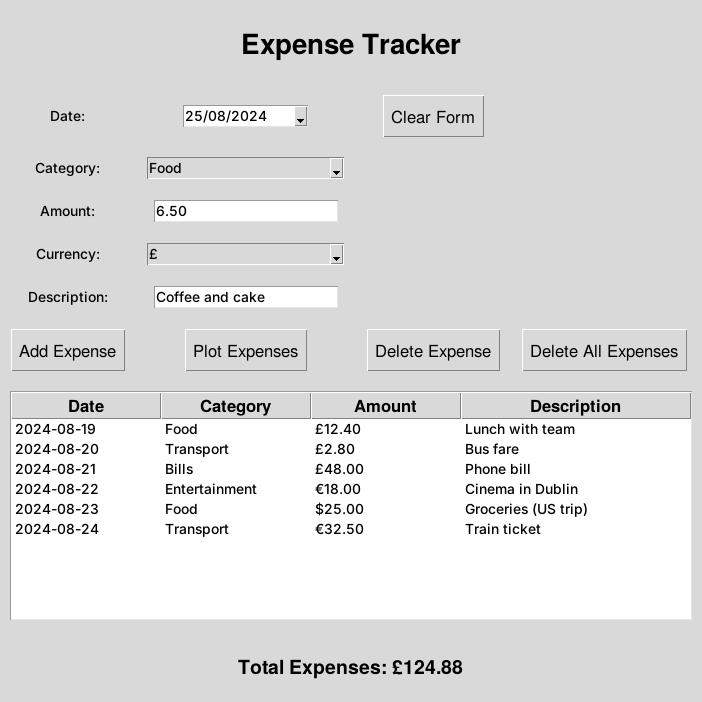

# Personal Expense Tracker

[](https://github.com/mcneillium/expense-tracker/actions/workflows/tests.yml)

Case study: [paulmartinmcneill.com/projects/expense-tracker](https://paulmartinmcneill.com/projects/expense-tracker/)



## Overview
The Personal Expense Tracker is a user-friendly application designed to help individuals track their daily expenses, categorize them, and visualize spending habits. It is ideal for those who want to manage their finances more effectively by keeping a record of where their money goes.

## Features
- **Add Expenses**: Easily log your expenses with details such as date, category, amount, and description.
- **Categorize Expenses**: Organize your expenses by categories such as Food, Transport, Entertainment, Bills, and Other.
- **Delete Expenses**: Remove specific expenses or delete all expenses at once.
- **View Expense Summary**: Get a summary of your total expenses in GBP, converted from various currencies.
- **Visualize Spending**: Use built-in tools to plot and visualize your spending trends by category.
- **Clear Input Form**: Reset the input form to its default state after adding an expense.
- **Stylish Interface**: A clean and modern interface for a pleasant user experience.
- **Responsive Layout**: The application window centers itself on the screen for better accessibility.

## Technologies Used
- **Programming Language**: Python
- **Libraries**:
  - **pandas**: For data manipulation and handling CSV files.
  - **Matplotlib**: For creating visualizations of spending trends.
  - **tkinter**: For building the graphical user interface.
  - **tkcalendar**: For selecting dates easily within the GUI.
  - **ttk**: For enhanced widget styling in the interface.

## Installation
You need [uv](https://docs.astral.sh/uv/), which fetches the right Python (3.13
or later, with Tkinter included) and every dependency from the lock file.

```bash
git clone https://github.com/mcneillium/expense-tracker.git
cd expense-tracker
uv run main_gui.py
```

## Usage
1. **Adding Expenses**: Enter the date, category, amount, currency, and a brief description of the expense, then click "Add Expense".
2. **Viewing Expenses**: All added expenses are displayed in a table view with details. You can see the total expenses in GBP at the bottom.
3. **Deleting Expenses**: Select an expense from the table and click "Delete Expense" to remove it. Click "Delete All Expenses" to clear the entire list.
4. **Visualizing Spending**: Click "Plot Expenses" to generate a bar chart showing your spending by category.
5. **Clearing the Form**: Click "Clear Form" to reset the input fields.

## Tests
```bash
uv run pytest     # the tests
uv run mypy       # the type check
```
The currency conversion, the per-category chart totals and the file operations (delete one, delete all) are tested, and the
tests run on every push. Conversion rates are fixed examples in `money.py`,
not live exchange rates.

## Changes (November 2026)
- **Delete All Expenses** now empties the file. Before, it only recreated the
  file when it was missing, so nothing was deleted.
- **Delete Expense** removes exactly the selected row. Before, it matched on the
  row's values, so deleting one of two identical expenses deleted both.
- The window sizes itself to its contents; the fixed 800x650 window hid the
  total. File handling lives in `store.py`, with its own tests.
- The spending chart now converts every amount to pounds before adding them
  up; it used to add dollars, euros and yen to pounds as if they were the same.
- `requirements.txt` now lists what the app actually uses (it was missing
  `tkcalendar` and listed Flask and Plotly, which are not used).
- The committed `venv/` folder (about 38,000 files) is no longer tracked.

### Second round (November 2026): exact money and current tooling
- **Money is held as `Decimal`, not `float`**, so totals are exact to the
  penny (in floating point, 0.10 + 0.20 is 0.30000000000000004).
- The amount box now refuses `nan`, `inf`, zero and negative numbers. Before,
  typing `nan` saved an expense of "£nan".
- **uv** manages Python and the dependencies from one `pyproject.toml` and a
  lock file, replacing `requirements.txt`. **Ruff** lints and formats, and
  **mypy** checks the money and file-handling modules in strict mode.
- Tests went from 6 to 14 and run on **Python 3.13, 3.14 and 3.15**. Dependabot
  proposes updates once a month.
- Removed `expense_tracker.py`, an unused first draft that still added
  different currencies together.

## Contribution
Contributions are welcome! Please feel free to submit a pull request or open an issue if you have suggestions or find any bugs.

## License
This project is licensed under the MIT License. See the `LICENSE` file for details.

## Contact
For any inquiries or feedback, please contact paulmcneill1989@hotmail.co.uk.
